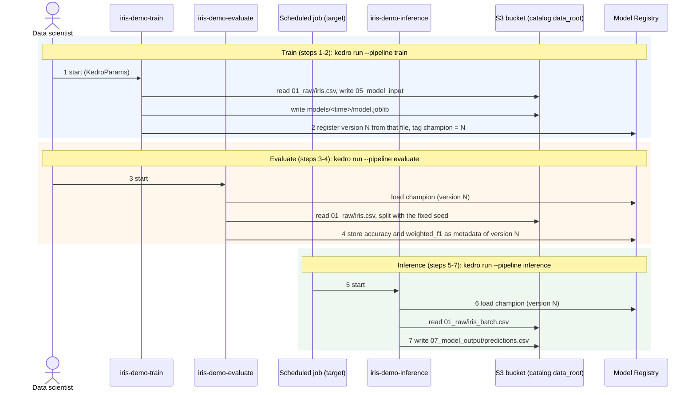
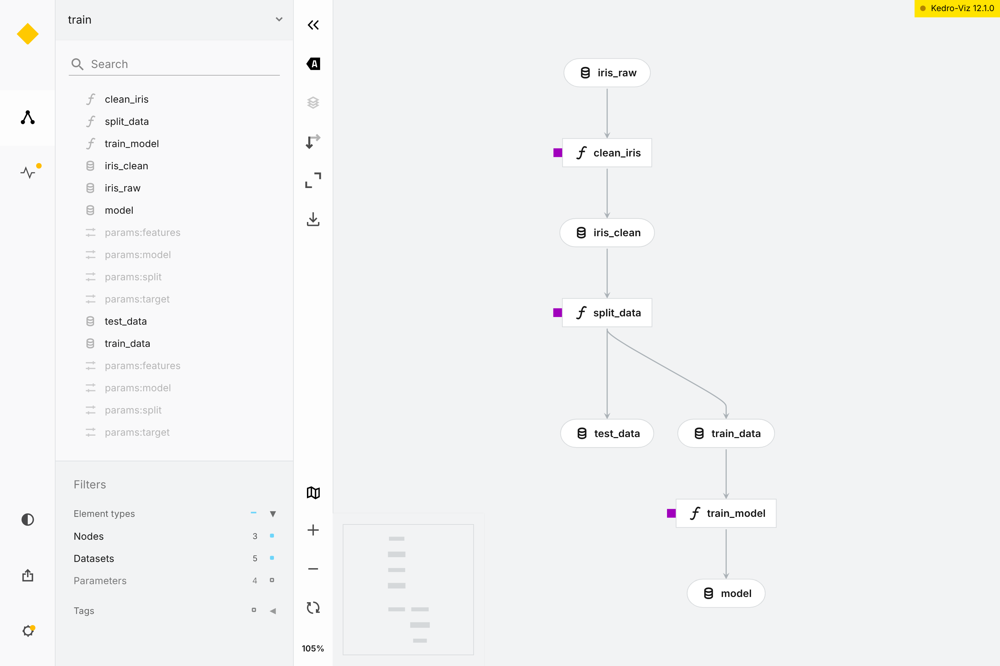
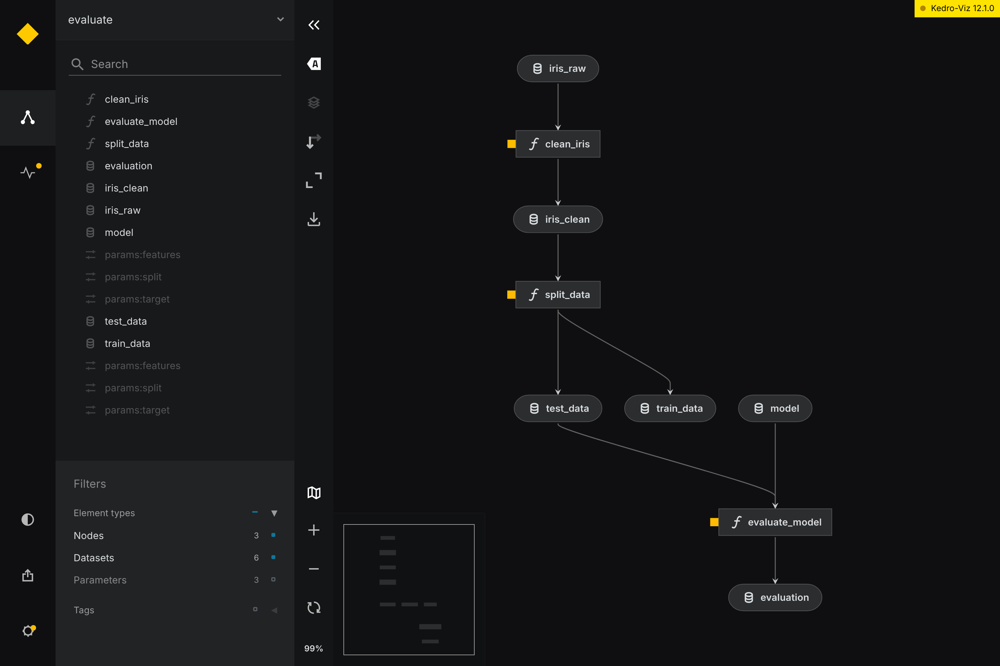
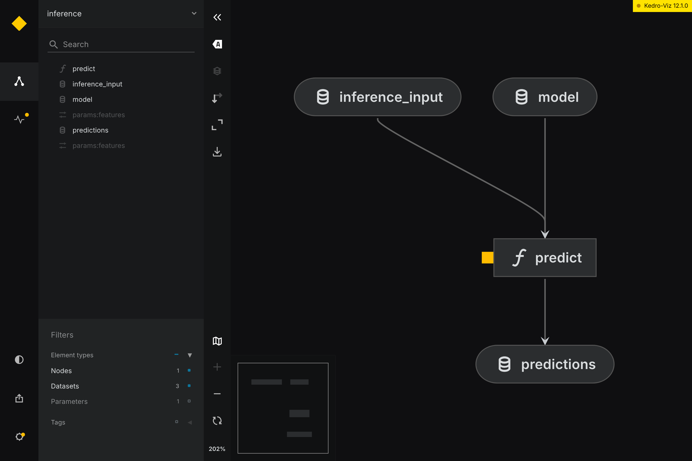

# Kedro iris on SageMaker Pipelines

This Kedro project trains, evaluates and scores an iris model on SageMaker.
Three SageMaker pipelines wrap the three Kedro pipelines `train`, `evaluate`
and `inference`. Each pipeline runs the project's own Docker image from ECR.
The model lives in the SageMaker Model Registry. A Kedro dataset registers it
and loads it. Thus, all ML logic and all data access stay in the Kedro project,
and SageMaker only supplies the compute.

## How it works


The diagram shows three flows:

- Steps 1–2 show the train pipeline.
- Steps 3–4 show the evaluate pipeline.
- Steps 5–7 show the inference pipeline.

The sequence diagram below uses the same step numbers.

**Snowflake and the EventBridge schedule are the target design.** The deployed
pipelines read `iris.csv` and `iris_batch.csv` from the project S3 bucket and
write `predictions.csv` to the same bucket. To start inference, run
`python deploy/pipelines.py run inference`.

The diagram source is [`docs/architecture/specs.json`](docs/architecture/specs.json).
You can edit a copy in draw.io: [`iris-demo-architecture.drawio`](docs/architecture/iris-demo-architecture.drawio).

### Sequence



- **Each SageMaker pipeline has one Processing step.** The step runs the project
  image on `ml.t3.medium`. The entry point of the image is
  `kedro run --env sagemaker`, and the step passes `--pipeline <name>` and
  `--params <KedroParams>`. The step has no inputs and no outputs, and nothing
  is installed when the job starts.
- **The image is yours.** The [`Dockerfile`](Dockerfile) starts from
  `python:3.11-slim`, installs `requirements.txt` and copies the Kedro project.
  `deploy/build_image.py` builds it and pushes it to ECR. `deploy/pipelines.py deploy`
  pins the digest of the `latest` image in the pipelines. Thus, a new image
  changes the pipelines only when you deploy again.
- **The Kedro catalog does all data access.** `conf/sagemaker/globals.yml` sets
  `data_root` to `s3://<bucket>/data`. The deploy script puts the bucket name
  into the `IRIS_BUCKET` variable of each job. Thus, the catalog is the same on
  your computer and on SageMaker, and a different source, for example a
  Snowflake table, is a change in the catalog only.
- **The model is a Kedro dataset.** `SageMakerModelDataset` in
  [`src/iris_demo/datasets`](src/iris_demo/datasets) writes the model with
  joblib to S3, registers a new version in the model package group with that
  file as its source, and sets the tag `champion=<version>` on the group. On
  load, it reads the version in the tag and downloads the file. The registry
  entry has no inference container, because Kedro runs the inference.
- **The metrics are a Kedro dataset.** `SageMakerModelMetricsDataset` stores the
  result of `evaluate_model` as metadata of the champion version. The Model
  Registry shows the metadata next to the version.
- **The tags are on the model package group.** SageMaker cannot put a tag on a
  single version. The group has one `champion` tag, thus only one champion
  exists. The datasets have `save_args` and `load_args` with a `tag`
  parameter. This project saves with `champion` and loads `champion`.
- **Train sets the champion by default.** Evaluate and inference use the
  champion by default. The Kedro runtime parameter `model_tag` selects another
  tag for one run: `KedroParams=model_tag=challenger` registers a challenger
  and leaves the champion as it is, evaluates the challenger, or scores with
  it. `python deploy/registry.py promote <version>` moves the champion tag.

## Kedro pipelines

| Kedro pipeline | Nodes | SageMaker pipeline | Reads | Writes |
|---|---|---|---|---|
| `train` | clean_iris, split_data, train_model | `iris-demo-train` | `iris_raw` | `model` (registry) |
| `evaluate` | clean_iris, split_data, evaluate_model | `iris-demo-evaluate` | `iris_raw`, `model` | `evaluation` (registry metadata) |
| `inference` | predict | `iris-demo-inference` | `inference_input`, `model` | `predictions` |

`__default__` runs `train` and `evaluate` together for local work. The `evaluate`
pipeline repeats the split. The split has a fixed seed, thus the test rows are
the rows that `train` held out.

| `kedro viz` of `train` | `evaluate` | `inference` |
|---|---|---|
|  |  |  |

## Usage

```bash
cp .env.sample .env                         # then put your AWS credentials in .env
uv venv --python 3.11 .venv && uv pip install --python .venv/bin/python -r requirements-dev.txt
source .venv/bin/activate

kedro run                                   # local: train and evaluate with the local data folder
kedro run --pipeline inference              # local: score data/01_raw/iris_batch.csv
kedro viz run                               # show the pipelines in the browser
pytest                                      # unit tests, no AWS account needed

python deploy/setup_infra.py                # make the bucket and data, the ECR repository, the IAM roles, the registry group, Studio
python deploy/build_image.py                # build the project image and push it to ECR (needs Docker)
python deploy/pipelines.py deploy           # make or update the three pipelines with the latest image

python deploy/pipelines.py run train        # register a new champion
python deploy/pipelines.py run train -p KedroParams=model.n_estimators=200,model.max_depth=4
python deploy/pipelines.py run evaluate     # store the metrics of the champion in the registry
python deploy/pipelines.py run inference    # score with the champion

python deploy/pipelines.py run train -p KedroParams=model_tag=challenger      # register a challenger, champion unchanged
python deploy/pipelines.py run evaluate -p KedroParams=model_tag=challenger   # store the metrics of the challenger
python deploy/pipelines.py run inference -p KedroParams=model_tag=challenger  # shadow test with the challenger
python deploy/registry.py list                                                # versions, tags, metrics
python deploy/registry.py promote 2                                           # champion = version 2

python deploy/teardown.py --yes             # delete all project resources
```

The deploy scripts read only the AWS values from `.env`: `AWS_ACCESS_KEY_ID`,
`AWS_SECRET_ACCESS_KEY`, `AWS_SESSION_TOKEN` and `AWS_REGION`. The file
`.env.sample` shows the format. If the environment already has credentials or
`AWS_PROFILE`, the scripts do not read `.env`.

After a run, the `run` command prints the result: the champion version and its
metadata after `train` and `evaluate`, the S3 path of the predictions after
`inference`.

On a computer without Docker, the package `sagemaker-studio-image-build` builds
the same Dockerfile in AWS CodeBuild:
`pip install sagemaker-studio-image-build && sm-docker build . --repository iris-demo:latest`.

## Layout

```
Dockerfile           the project image: python:3.11-slim, requirements.txt, the Kedro project
conf/base            catalog and parameters       conf/sagemaker   data_root on S3, registry datasets
src/iris_demo        Kedro pipelines: data_processing, training, evaluation, inference
src/iris_demo/datasets   SageMakerModelDataset, SageMakerModelMetricsDataset
deploy/build_image.py    build the image, push it to ECR
deploy/pipelines.py  SageMaker pipeline definitions, the deploy and run commands
deploy/registry.py   list the model versions, promote a challenger
deploy/setup_infra.py, teardown.py
tests                unit tests with a stubbed SageMaker client
docs/architecture    diagram spec and renderer (aniryou/drawing-skills architecture-skill)
docs/kedro-viz       screenshots of kedro viz
```

A script makes the architecture diagram. Do not edit the diagram files. To
change the diagram:

1. Edit `docs/architecture/specs.json`.
2. Run `uv run --no-project --with diagrams python docs/architecture/generate.py docs/architecture/specs.json docs/architecture`.

The sequence diagram is the Mermaid block above. GitHub shows it in the page.

## SageMaker Studio

The script `setup_infra.py` makes the Studio domain `iris-demo-studio`. The
domain has one user profile, `default-user`. The domain uses public internet
access. Thus, it does not use a NAT gateway and has no fixed cost.

To open Studio:

1. In the AWS console, go to SageMaker AI > Domains > iris-demo-studio.
2. Select User profiles > Launch > Studio.

The pipeline graphs are in **Pipelines**. The registry is in
**Models > Registered models > iris-demo-models**. Each version shows its
source file, its approval status and the metrics in its metadata. The group
shows the `champion` tag.

AWS bills Studio spaces (JupyterLab, Code Editor) only while they run. Stop each
space after use.

## Limits of this account

- The account has a Processing quota only for `ml.t3.*`. All three pipelines
  use `ml.t3.medium`. The iris model trains in seconds.
- SageMaker Processing instances are x86_64. `build_image.py` builds the image
  with `--platform linux/amd64`, also on an ARM computer.
- A model version has only a source URI and no inference container. To use a
  version on a SageMaker endpoint or in a Transform job, add an inference
  specification to it.
