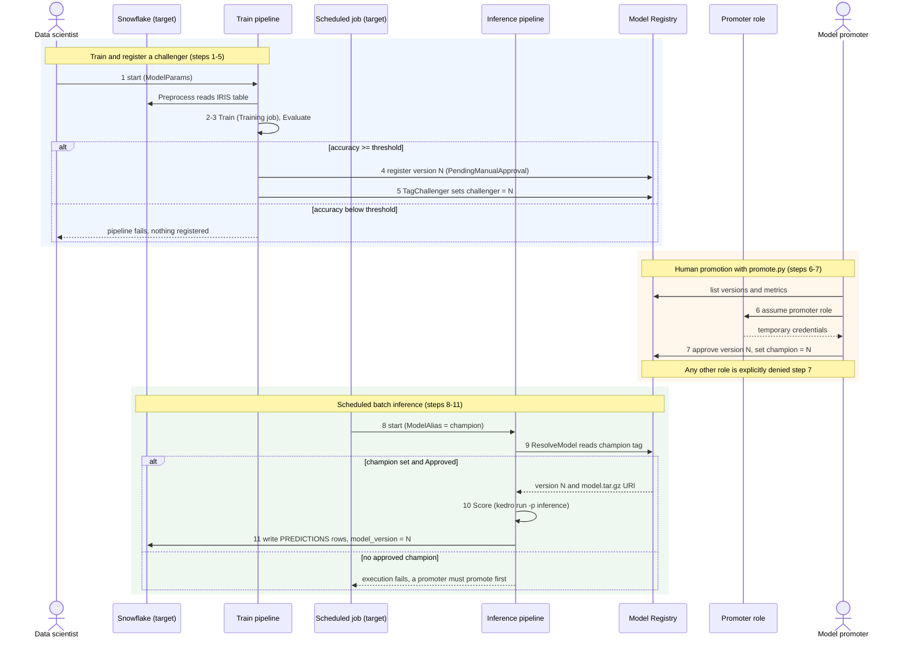

# Kedro iris on SageMaker Pipelines with champion/challenger promotion

A Kedro project (spaceflights-style layout, iris data) that trains and scores on
SageMaker Pipelines. Models are versioned in the SageMaker Model Registry, and a
human with the right IAM role decides which version the inference pipeline uses.

## How it works


Steps 1–5 are the train pipeline, 6–7 the human promotion, 8–11 the inference
pipeline; the sequence diagram below uses the same numbers. **Snowflake as the
data source and sink, and the EventBridge schedule, are the target design**: the
deployed pipelines still read `iris.csv` from and write `predictions.csv` to the
project S3 bucket, and inference is started on demand with
`python deploy/pipelines.py run inference`. Diagram source: [`docs/architecture/specs.json`](docs/architecture/specs.json)
(editable copy: [`iris-demo-architecture.drawio`](docs/architecture/iris-demo-architecture.drawio)).

### Sequence



`ModelAlias = challenger` runs the same inference flow against the challenger
for shadow scoring; `promote.py rollback` moves `champion` back to
`previous_champion`.

- **Kedro is the only place with ML logic.** Train is a SageMaker Training job
  (`ml.m5.large`, entry point `deploy/train_entry.py`); the other compute steps
  are Processing jobs (`ml.t3.medium`, entry point `deploy/entrypoint.py`).
  Each one runs `kedro run --env sagemaker --pipeline <name>`. `conf/sagemaker`
  only changes the data root, so the catalog is the same locally and remotely.
- **Aliases are tags on the model package group**: `champion=<version>` and
  `challenger=<version>`. SageMaker does not allow tags on individual model
  versions, and one pointer per alias means there is never more than one champion.
- **The inference pipeline resolves `champion` at run time**, so a promotion
  takes effect on the next execution without redeploying anything.
- **Training never promotes.** A model that passes the quality gate becomes the
  `challenger` and stays `PendingManualApproval` until a promoter acts.

## Who can promote

| Role | set `champion` | set `challenger` | approve version | start pipelines |
|---|---|---|---|---|
| `iris-demo-model-promoter` | yes | yes | yes | no |
| `iris-demo-data-scientist` | no (explicit deny) | no | no | yes |
| `iris-demo-sagemaker-execution` (pipelines run as this) | no (explicit deny) | no | no | yes |
| `iris-demo-registry-lambda` | no | yes | no | no |
| `iris-demo-studio-user` (SageMaker Studio) | no (explicit deny) | no | no | yes |

The gate is `sagemaker:AddTags` on the group ARN, restricted with `aws:TagKeys`,
plus `sagemaker:UpdateModelPackage` for approval. `python deploy/check_access.py`
prints this table from the live IAM policies.

To authorize a person, add their IAM user to the group `iris-demo-model-promoters`
(it allows assuming the promoter role) and give them a profile:

```ini
# ~/.aws/config
[profile iris-promoter]
role_arn = arn:aws:iam::<account>:role/iris-demo-model-promoter
source_profile = <their own profile>
```

Account administrators and the root user can always change tags; this model
constrains everyone else.

## Usage

```bash
uv venv --python 3.9 .venv && uv pip install --python .venv/bin/python -r requirements-dev.txt
source .venv/bin/activate

kedro run                                   # local: preprocess + train + evaluate
kedro run --pipeline inference              # local: score data/01_raw/iris_batch.csv

python deploy/setup_infra.py                # bucket, IAM, Lambda, registry group (idempotent)
python deploy/pipelines.py deploy           # package the project, create/update both pipelines

python deploy/pipelines.py run train
python deploy/pipelines.py run train -p ModelParams=model.n_estimators=200,model.max_depth=4
python deploy/promote.py list               # versions, metrics, aliases
AWS_PROFILE=iris-promoter python deploy/promote.py promote      # challenger -> champion
python deploy/pipelines.py run inference    # scores with the champion
python deploy/pipelines.py run inference -p ModelAlias=challenger   # shadow-score the challenger
AWS_PROFILE=iris-promoter python deploy/promote.py rollback     # previous champion

python deploy/teardown.py --yes             # delete everything
```

The deploy scripts read only `AWS_ACCESS_KEY_ID`, `AWS_SECRET_ACCESS_KEY` and
`AWS_REGION` from `.env`, and only when no credentials or `AWS_PROFILE` are
already set in the environment.

`promote` refuses a version whose test accuracy is below the champion's unless
`--force` is given. The comparison is fair because the test split is seeded, so
every version is scored on the same rows.

## Layout

```
conf/base            catalog, parameters          conf/sagemaker   data root override
src/iris_demo        Kedro pipelines: data_processing, data_science, inference
deploy/pipelines.py  SageMaker pipeline definitions + run command
deploy/promote.py    list / promote / rollback
deploy/setup_infra.py, teardown.py, check_access.py
deploy/entrypoint.py     runs in the Processing containers
deploy/train_entry.py    runs in the Training container
deploy/registry_lambda.py  resolves / sets aliases for the pipelines
docs/architecture    diagram spec + renderer (aniryou/drawing-skills architecture-skill)
```

The architecture diagram is generated, never hand-edited: change
`docs/architecture/specs.json`, then run
`uv run --no-project --with diagrams python docs/architecture/generate.py docs/architecture/specs.json docs/architecture`.
The sequence diagram is the Mermaid block above (GitHub renders it inline).

## Browsing in SageMaker Studio

`setup_infra.py` creates the Studio domain `iris-demo-studio` with a
`default-user` profile (public internet access, so no NAT gateway and no fixed
cost). Open it from the console: SageMaker AI -> Domains -> iris-demo-studio ->
User profiles -> Launch -> Studio. Pipeline graphs are under **Pipelines**; the
registry is under **Models -> Registered models -> iris-demo-models**. Studio
users can run pipelines but cannot promote. Only running Studio spaces
(JupyterLab, Code Editor) are billed; stop them when done.

## Constraints of this account

- Training quota exists for `ml.m5.large` (raised on request); Processing
  quota only for `ml.t3.*`; there is no Transform-job quota, so batch
  inference runs as a Processing job.
- Kedro is pip-installed at job start into the stock scikit-learn 1.2-1 image.
  A custom image with the requirements baked in would start faster.
- The registered model package holds `model.joblib` only. It is consumed by the
  batch inference pipeline; deploying it to a real-time endpoint would also need
  an inference script.
