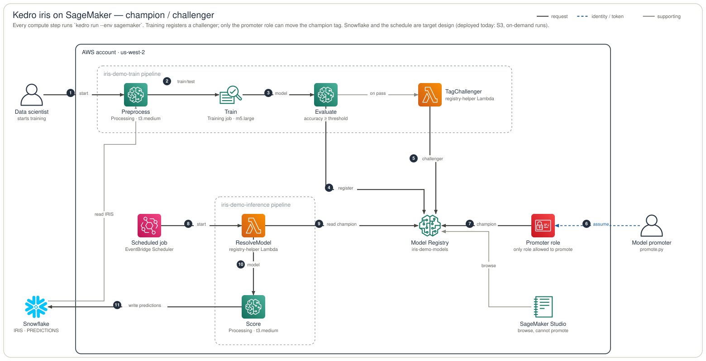
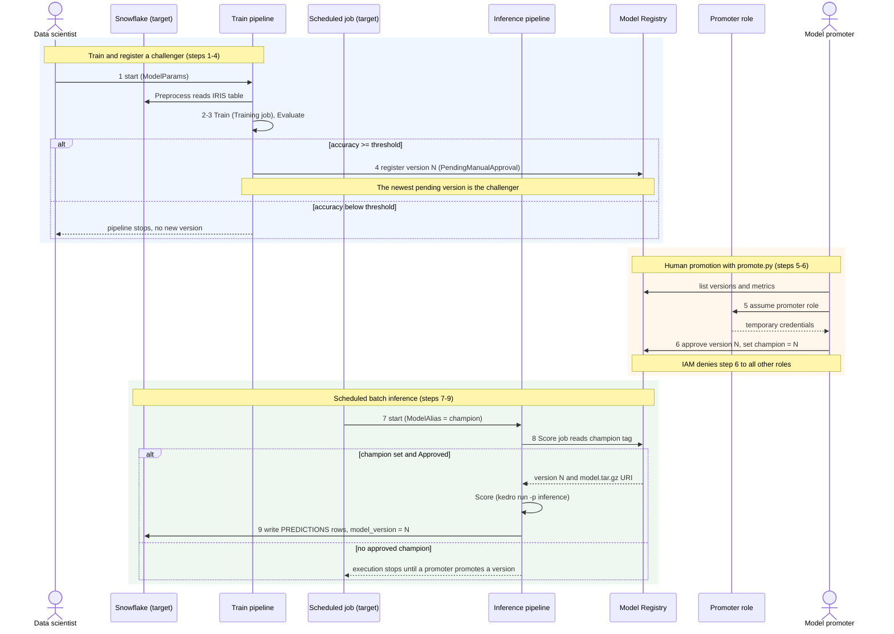

# Kedro iris on SageMaker Pipelines with champion/challenger promotion

This Kedro project trains and scores an iris model on SageMaker Pipelines. The
project uses the Kedro spaceflights layout. The SageMaker Model Registry keeps
each version of the model. A person with the promoter IAM role selects the
version that the inference pipeline uses.

## How it works



The diagram shows three flows:

- Steps 1–4 show the train pipeline.
- Steps 5–6 show the promotion by a person.
- Steps 7–9 show the inference pipeline.

The sequence diagram below uses the same step numbers.

**Snowflake and the EventBridge schedule are the target design.** The deployed
pipelines read `iris.csv` from the project S3 bucket. They write
`predictions.csv` to the same bucket. To start inference, run
`python deploy/pipelines.py run inference`.

The diagram source is [`docs/architecture/specs.json`](docs/architecture/specs.json).
You can edit a copy in draw.io: [`iris-demo-architecture.drawio`](docs/architecture/iris-demo-architecture.drawio).

### Sequence



The challenger is the newest version with the status `PendingManualApproval`.
With `ModelAlias = challenger`, the inference pipeline scores with the
challenger. Use this for a shadow test. The command `promote.py rollback` sets
`champion` to the version in `previous_champion`.

- **All ML logic is in Kedro.** The Train step is a SageMaker Training job on
  `ml.m5.large`. Its entry point is `deploy/train_entry.py`. The other compute
  steps are Processing jobs on `ml.t3.medium`. Their entry point is
  `deploy/entrypoint.py`. Each step runs `kedro run --env sagemaker --pipeline <name>`.
  The `conf/sagemaker` environment changes only the data root. Thus, the
  catalog is the same on your computer and on SageMaker.
- **The champion is a tag on the model package group.** The tag is
  `champion=<version>`. SageMaker cannot put tags on a single model version.
  The group has one `champion` tag, thus only one champion can exist.
- **The challenger has no tag.** It is the newest version with the status
  `PendingManualApproval`.
- **The Score job reads the `champion` tag when it starts.** Then it downloads
  that model from S3. Thus, a promotion changes the next execution. You do not
  deploy the pipeline again. The inference pipeline has only this one step.
- **The train pipeline does not promote.** A model that passes the quality gate
  becomes the `challenger`. Its status is `PendingManualApproval` until a
  promoter approves it.

## Who can promote

| Role | set `champion` | approve version | start pipelines |
|---|---|---|---|
| `iris-demo-model-promoter` | yes | yes | no |
| `iris-demo-data-scientist` | no (explicit deny) | no | yes |
| `iris-demo-sagemaker-execution` (the pipelines use this role) | no (explicit deny) | no | yes |
| `iris-demo-studio-user` (SageMaker Studio) | no (explicit deny) | no | yes |

IAM controls two actions:

- `sagemaker:AddTags` on the group ARN. The condition key `aws:TagKeys` limits
  which tags a role can set.
- `sagemaker:UpdateModelPackage`, which approves a version.

The command `python deploy/check_access.py` shows this table from the current
IAM policies.

To give a person the promoter role:

1. Add the IAM user of the person to the group `iris-demo-model-promoters`.
   Members of this group can assume the promoter role.
2. Give the person this AWS profile:

```ini
# ~/.aws/config
[profile iris-promoter]
role_arn = arn:aws:iam::<account>:role/iris-demo-model-promoter
source_profile = <their own profile>
```

Account administrators and the root user can always change tags. These IAM
rules apply to all other users.

## Usage

```bash
cp .env.sample .env                         # then put your AWS credentials in .env
uv venv --python 3.9 .venv && uv pip install --python .venv/bin/python -r requirements-dev.txt
source .venv/bin/activate

kedro run                                   # local: preprocess, train, evaluate
kedro run --pipeline inference              # local: score data/01_raw/iris_batch.csv

python deploy/setup_infra.py                # make the bucket, IAM roles, registry group, Studio
python deploy/pipelines.py deploy           # package the project, make or update the pipelines

python deploy/pipelines.py run train
python deploy/pipelines.py run train -p ModelParams=model.n_estimators=200,model.max_depth=4
python deploy/promote.py list               # show versions, metrics, aliases
AWS_PROFILE=iris-promoter python deploy/promote.py promote      # make the challenger the champion
python deploy/pipelines.py run inference    # score with the champion
python deploy/pipelines.py run inference -p ModelAlias=challenger   # score with the challenger (shadow test)
AWS_PROFILE=iris-promoter python deploy/promote.py rollback     # go back to the previous champion

python deploy/teardown.py --yes             # delete all project resources
```

The deploy scripts read only the AWS values from `.env`: `AWS_ACCESS_KEY_ID`,
`AWS_SECRET_ACCESS_KEY`, `AWS_SESSION_TOKEN` and `AWS_REGION`. The file
`.env.sample` shows the format. If the environment already has
credentials or `AWS_PROFILE`, the scripts do not read `.env`.

The `promote` command does not promote a version that has a lower test accuracy
than the champion. To promote it, add `--force`. The comparison is correct
because the test split uses a fixed seed. Thus, each version gets a score on the
same rows.

## Layout

```
conf/base            catalog, parameters          conf/sagemaker   data root override
src/iris_demo        Kedro pipelines: data_processing, training, evaluation, inference
deploy/pipelines.py  SageMaker pipeline definitions and the run command
deploy/promote.py    list, promote, rollback
deploy/setup_infra.py, teardown.py, check_access.py
deploy/entrypoint.py     runs in the Processing containers, finds the champion for Score
deploy/train_entry.py    runs in the Training container
docs/architecture    diagram spec and renderer (aniryou/drawing-skills architecture-skill)
```

A script makes the architecture diagram. Do not edit the diagram files. To
change the diagram:

1. Edit `docs/architecture/specs.json`.
2. Run `uv run --no-project --with diagrams python docs/architecture/generate.py docs/architecture/specs.json docs/architecture`.

The sequence diagram is the Mermaid block above. GitHub shows it in the page.

## SageMaker Studio

The script `setup_infra.py` makes the Studio domain `iris-demo-studio`. The
domain has one user profile, `default-user`. The domain uses public internet
access. Thus, it does not use a NAT gateway and has no fixed cost.

To open Studio:

1. In the AWS console, go to SageMaker AI > Domains > iris-demo-studio.
2. Select User profiles > Launch > Studio.

The pipeline graphs are in **Pipelines**. The registry is in
**Models > Registered models > iris-demo-models**. Studio users can run
pipelines, but they cannot promote a model.

AWS bills Studio spaces (JupyterLab, Code Editor) only while they run. Stop each
space after use.

## Limits of this account

- The account has a Training quota for `ml.m5.large`. AWS increased this quota
  on request.
- The account has a Processing quota only for `ml.t3.*`.
- The account has no Transform job quota. Thus, batch inference runs as a
  Processing job.
- Each job installs Kedro with pip when it starts. The job uses the standard
  scikit-learn 1.2-1 image. A custom image with Kedro installed starts faster.
- The registered model package contains only `model.joblib`. The batch
  inference pipeline uses this file. A real-time endpoint also requires an
  inference script.
